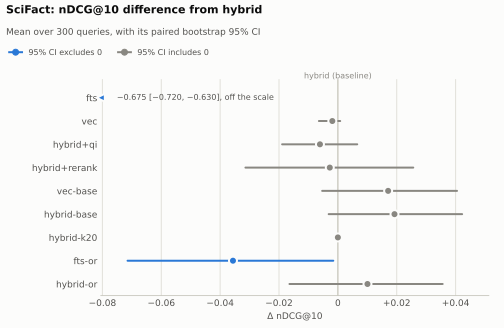
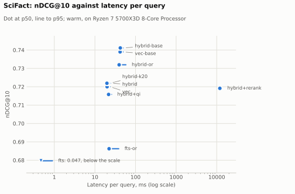
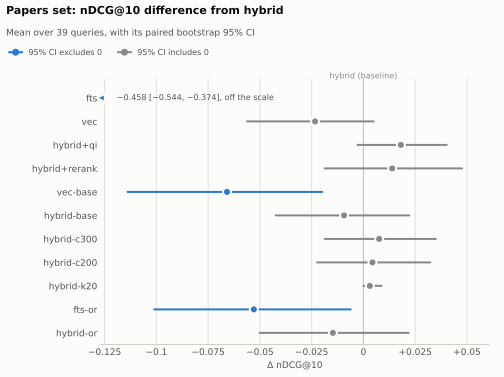
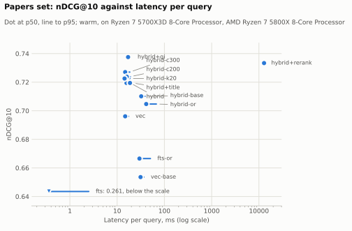

# Alexandria retrieval report

How well Alexandria's search retrieves, measured on BEIR SciFact and on a
set of public arXiv papers, with the hypotheses and plan changes recorded
before the results they bear on. See [README.md](README.md) for how to run
the harness.

## Hypotheses (pre-registered)

Written on 2026-10-23, before any eval run. They are recorded here unedited
so the results can be checked against them rather than the other way round.
Each will be reported as **supported**, **not supported**, or
**inconclusive** (the 95% CI crosses zero). Being wrong about one is fine
and worth saying.

- **H1:** `hybrid` ≥ both `fts` and `vec` on nDCG@10, on both datasets.
- **H2:** `hybrid+qi` gives a small, positive change.
- **H3:** `hybrid+rerank` improves nDCG@10 the most, at a large p95 latency cost.
- **H4:** hits with `matched_in = both` are more precise than single-retriever hits.
- **H5:** smaller chunks improve the papers set.
- **H6:** for queries of 5+ words, `hybrid-or` beats `hybrid` on nDCG@10.

### Further predictions from reading the code

Also made before any run, while reading `search.py` and `ingest/`:

- **P1:** FTS joins query words with an implicit AND (both on the first,
  raw-syntax attempt and in the `_quote_terms` fallback), and the FTS5
  tokenizer keeps stopwords. SciFact queries are full-sentence claims, so
  `fts` will return nothing for a large share of them and score well below
  the published BM25 numbers. Where FTS returns nothing, `hybrid` ranks
  exactly as `vec` does, so `hybrid` will sit close to `vec` on SciFact.
- **P2:** chunks are 800 *words*, but `bge-small-en-v1.5` truncates its
  input at 512 tokens, so the vector side only sees roughly the first
  400 words of each full-size chunk. SciFact abstracts are short, so this
  should matter little there; on the papers set it should favour smaller
  chunks (H5).

## Changes to the plan

Recorded before any papers-set results exist.

- **2026-10-23: `hybrid-c400` is replaced by `hybrid-c300`** (300-word
  chunks, 50-word overlap), on Voidwolf's call: a 400-word chunk is still
  about 630 bge tokens on SciFact's text, over the 512-token window, so it
  wouldn't test chunks that fit. `hybrid-c200` (200/40) stays. The 50-word
  overlap for c300 (17% of the chunk) was chosen to sit between c400's
  12.5% and c200's 20%.
  - *Measured afterwards, on the papers set:* its text averages 1.77 bge
    tokens per word, so 300-word chunks still overflow 512 tokens 37.6% of
    the time (200-word chunks 8.3%). Reported to Voidwolf; c300 stands unless
    he changes it, and any change is recorded here before papers results.
  - *Scripted later* (`evals.tokens`, from the committed indexes): 37.3% and
    7.9%. The one-off counts were taken before the PDF upload path was
    pinned (`bb3ed39`), the likeliest reason for the difference; see
    [What the embedding model sees](#what-the-embedding-model-sees-p2).
- **2026-10-23: the `fts-or` / `hybrid-or` definition is frozen** as used in
  a scratch SciFact run on the same day, and won't change before the papers
  results:
  - split the query on whitespace; drop words containing no letter or
    digit; wrap each remaining word in double quotes (doubling any `"`
    inside it); join them with ` OR `;
  - `fts-or` passes that expression to FTS5 as the MATCH query;
  - `hybrid-or` uses it on the FTS side only; the vector side embeds the
    original query; fusion (RRF, k = 60) and candidate depth are as in
    `hybrid`;
  - a query with no remaining words gets no FTS results.

  Disclosure: that scratch run is the only OR formulation tried, and its
  SciFact score (nDCG@10 0.686 for `fts-or`) was seen before this
  definition was frozen. The same scratch run tried `vec` with BGE's query
  instruction (0.713, below plain `vec`'s 0.720). Neither number has
  tuned anything. Both are re-measured as committed variants in phase 4.
- **2026-10-23: each `lookup` and `paraphrase` has its target paper graded
  2 before judging** (31 grades in `qrels.tsv`), on Voidwolf's call. Pooled
  judging only grades papers some variant returned. So a query whose
  target every variant missed, and which turned up nothing else relevant,
  would have no relevant papers and be left out of every mean. The misses
  that matter most would vanish instead of scoring 0. Those 31 pairs aren't
  graded blind; they are relevant because the query was written for them.
- **2026-10-23: eight `paraphrase` queries are LLM-drafted**, marked
  `llm-draft`. Voidwolf's notes had four paraphrases against a target of
  about twelve. A mix also matches how Alexandria is used, since agents
  query it as well as people.
  - *Papers:* the 20 with no `lookup` or `paraphrase` written for them,
    sorted by arXiv id, sampled with `random.Random(0).sample(pool, 8)`:
    BEIR, ALCE, C-Pack, SWE-bench, Control Illusion, When Reject Turns into
    Accept, Health-ORSC-Bench, Passing the Test You Trained On.
  - *Drafter:* a fresh Claude Opus 5.5 subagent with none of this project's
    context: not the hypotheses, the search code or the other queries. It
    got a file of each paper's title and abstract, taken from the pinned
    PDF, and this prompt (the file's path elided):

    > You are helping build a test set for a personal search tool. Someone
    > keeps a private library of research-paper PDFs and searches it by
    > typing queries. We need search queries to test it with.
    >
    > Read the one file `<titles and abstracts>` with the Read tool. It
    > holds 8 papers, each as `[arXiv id] title` followed by the abstract.
    > Use no other tools and no other sources: don't search, don't open
    > other files, don't look anything up.
    >
    > For each paper, write one query of this type:
    >
    >   paraphrase: one paper's idea in words different from the paper's.
    >
    > Write it the way the library's owner would type it into the search
    > box: someone who read the paper a while ago, remembers the idea, and
    > wants to find it again. One query per paper, 8 in all.
    >
    > Reply with only 8 lines of JSON, one per paper, in the order the file
    > lists them, like:
    > {"paper": "2104.08663", "text": "..."}

    Its eight lines are used unedited.
  - *Caveat:* all eight drafts are 17 to 22 words long, while the human
    queries run from 1 to 13 words. Any human-against-LLM comparison is
    therefore also a comparison of lengths and of papers, and is reported
    as description only.
- **2026-10-23: two of Voidwolf's notes were corrected against the pinned
  papers' text** before any run, by reading the papers, not by searching
  them. The RuLES lookup said 15 scenarios; the pinned v3 says 14. A ReAct
  lookup's placeholder became the name from the paper's worked example,
  "Arthur's Magazine was started in 1844".
- **2026-10-23: latency is timed after an untimed pass over every query**,
  replacing a single warm-up query. With one warm-up query, the variant run
  first in a process was slower: on the papers set `fts` took 3.0 ms at p50
  when run first and 0.4 ms when run last, and `vec` took 16.5 ms against
  14.2 to 14.8 ms. All committed latencies are re-measured this way;
  relevance results don't change.
- **2026-10-23: the papers summary reports `judged@10`** for each variant:
  the share of its top-10 papers that have a grade. A variant is scored
  only after its new pairs are graded, so this should read 100% in every
  reported result.
- **2026-10-23: the reranker's settings.** `hybrid+rerank` uses
  `BAAI/bge-reranker-base` on CPU over the top 50 fused chunks, the brief's
  defaults. The cross-encoder reads at most 512 tokens of query and chunk
  together, so it truncates long chunks, as the embedder does (P2).

## Decisions before the phase-4 grades

Recorded on 2026-10-25, after every variant had run on both sets and
before any of the 472 (query, paper) pairs new to the papers pool were
graded. By then the SciFact results for every variant had been seen, as
had the papers results for the three graded baselines and the other
variants' papers scores with their ungraded papers counted as not relevant
(`judged@10` 51–84%), which say little about those variants yet. The
phase-4 grades themselves had not been seen.

- **The rest runs on a second machine.** The machine that produced the
  committed rows is unavailable for about a week, so the remaining phases
  run on another (Ryzen 7 5800X, WSL2). Committed rows are not re-run: the
  judge reads passages by their stored chunk positions, and `--rescore`
  scores rows without searching, so rankings and latencies stay those of
  the first machine. The four papers indexes rebuilt here have the same
  cache keys as those the rows came from, which both tools check, and
  re-running all twelve papers variants here into a scratch folder
  reproduced every committed row's top 10, chunk positions and retriever
  ranks exactly. Any new timing is reported separately, with its hardware.
- **43 queries, not 50.** The brief targeted about 50. The set stays at
  43, on Voidwolf's call: every type is covered, with 12 paraphrases (the
  target) and 5 `no-answer`. Seven more queries would narrow the
  confidence intervals by about 7% (√(43/50) ≈ 0.93), but would mean
  re-running every papers variant and another round of grading, and they
  would be written knowing where search fails.
- **q42 keeps its type and its grade.** It was written as `no-answer`, and
  the blind judging pass graded one paper 1 for it (Health-ORSC-Bench,
  2601.17642). Neither changes now: the type was set before any run and the
  grade was given blind. The no-answer analysis counts it as answerable,
  with a note. A question written to have no answer that turns out to have
  a partial one is a small finding about writing such questions.
- **c300 stands.** No change to it was recorded before the papers results,
  as its entry above required.
- **Decision rules, set before the grades they apply to.** The brief
  leaves three product calls to Voidwolf until the results are in. Each
  gets its rule now, judged on the papers set by the nDCG@10 difference
  from `hybrid`, with the paired bootstrap 95% CI used throughout. None of
  the changes is made on this branch; each would be its own pull request.
  - *Reranking in the MCP tools.* Only if `hybrid+rerank`'s CI lies
    entirely above zero. Then it becomes an opt-in `rerank` parameter on
    `search_tool`, off by default, once its latency has been measured on a
    GPU. Otherwise it stays CLI-only, and the README says why.
  - *OR in keyword search.* The candidate is a fallback rather than either
    measured variant: run the query with AND, as now, and only if that
    finds nothing, run the OR expression frozen above. Where AND matches,
    this is exactly `hybrid`; where AND finds nothing, it is exactly
    `hybrid-or` (same FTS list, vector list and fusion). So it is scored
    from those two variants' rows without a new run: `hybrid-or`'s row for
    each query where `hybrid` had no FTS hits (`n_fts` = 0), `hybrid`'s row
    otherwise. Its latency comes from the same rows, which leaves out the
    failed AND attempt (under a millisecond on SciFact). It becomes the
    default if its CI's lower bound is above −0.02. It fixes a behaviour,
    natural-language queries silently falling back to vector-only search
    (P1), so it needs to show it costs nothing, not that it gains. The same
    change would stop reading an uppercase `OR`, `AND` or `NOT` in ordinary
    text as an FTS5 operator.

    *Disclosure:* the fallback is exploratory, not one of the
    pre-registered variants, and its SciFact score was computed and seen
    before this rule was set: nDCG@10 0.7327, +0.0108 [−0.0154, +0.0363]
    against `hybrid`; on queries of 5+ words, +0.0120 [−0.0137, +0.0373].
    H6 is still reported as registered, on `hybrid-or`.
  - *Chunk size.* The default changes only if `hybrid-c200` or
    `hybrid-c300` has a CI entirely above zero. If one does, chunks are
    sized by the embedding model's tokens rather than by words, since even
    300-word chunks overflow its 512-token window 37.6% of the time on this
    set, and the change comes with a way to re-index an existing corpus.

## Results

The tables between `<!-- report:… -->` markers are generated from
`results/` by `uv run python -m evals.report`, and the text around them is
written by hand. On the papers set, a table that depends on grades stays
empty until every variant's top 10 is judged, because each new grade can
move every variant's score. Latencies are warm, per `search()` call, on the
machine that produced the rows (Ryzen 7 5700X3D, 16 threads, WSL2, CPU
only). Δ is the difference from `hybrid`, the default install, with a
paired bootstrap 95% CI, in bold where the CI excludes zero.

### SciFact

Every variant has run and the judgements are BEIR's, so these results are
final.

<!-- report:main scifact -->
| Variant | nDCG@10 | Recall@5 | Recall@10 | MRR@10 | Δ nDCG@10 [95% CI] | p50 / p95 ms |
|---|---|---|---|---|---|---|
| `fts` | 0.0467 | 0.0458 | 0.0458 | 0.0500 | **−0.675 [−0.720, −0.630]** | 0.5 / 0.9 |
| `vec` | 0.7200 | 0.7653 | 0.8452 | 0.6845 | −0.002 [−0.006, +0.001] | 20.0 / 23.4 |
| `hybrid` | 0.7219 | 0.7686 | 0.8452 | 0.6872 | baseline | 21.0 / 24.3 |
| `hybrid+qi` | 0.7158 | 0.7607 | 0.8362 | 0.6876 | −0.006 [−0.019, +0.007] | 21.7 / 25.6 |
| `hybrid+rerank` | 0.7191 | 0.7682 | 0.8434 | 0.6873 | −0.003 [−0.031, +0.026] | 11,940 / 13,147 |
| `vec-base` | 0.7390 | 0.8221 | 0.8659 | 0.7019 | +0.017 [−0.005, +0.040] | 41.7 / 49.3 |
| `hybrid-base` | 0.7411 | 0.8212 | 0.8659 | 0.7053 | +0.019 [−0.003, +0.042] | 42.2 / 49.7 |
| `hybrid-k20` | 0.7219 | 0.7686 | 0.8452 | 0.6872 | +0.000 [+0.000, +0.000] | 19.8 / 23.7 |
| `fts-or` | 0.6863 | 0.7543 | 0.8249 | 0.6482 | **−0.036 [−0.071, −0.002]** | 22.3 / 38.6 |
| `hybrid-or` | 0.7319 | 0.7876 | 0.8629 | 0.6959 | +0.010 [−0.016, +0.036] | 39.5 / 58.0 |
<!-- /report -->

<picture>
  <source media="(prefers-color-scheme: dark)" srcset="results/charts/ndcg-scifact-dark.svg">
  
</picture>

<picture>
  <source media="(prefers-color-scheme: dark)" srcset="results/charts/latency-scifact-dark.svg">
  
</picture>

- **On SciFact's claims, the default install is vector search.** FTS's
  implicit AND finds nothing for 284 of the 300 queries, and on all 284
  `hybrid`'s top 10 is exactly `vec`'s, so the two are level (P1).
- **Two comparisons the [README](README.md#against-published-numbers)
  left open are now measured.** With its words joined by OR, FTS5's BM25
  scores 0.686, 0.007 above Anserini's flat BM25 (0.679): `fts`'s 0.047 is
  the query, not the ranking function. With BGE's query instruction,
  `hybrid+qi` (on SciFact, nearly vector search with the instruction)
  scores 0.716 against the published bge-small number with it (0.713), so
  most of the 0.007 gap the README noted between `vec` and that number is
  the instruction. It doesn't help: without it, `hybrid` scores 0.722.
- **Nothing beats `hybrid` with a CI clear of zero.** `hybrid-base` comes
  closest (+0.019 [−0.003, +0.042]), at twice the latency and three times
  the build time.
- **Reranking changes nothing here and costs about 12 s a query** on CPU
  (−0.003 [−0.031, +0.026]).
- **RRF k = 20 changes nothing:** `hybrid-k20` returns `hybrid`'s top 10
  for all 300 queries, the 16 FTS matched included.
- **OR alone loses to `hybrid`** (`fts-or`, −0.036 [−0.071, −0.002]), and
  OR nearly doubles the latency of a hybrid search (`hybrid-or`, 39.5 ms
  at p50 against 21.0 ms): FTS now matches almost every query, and has to
  rank what it matches.

### Papers set

<!-- report:main papers -->
| Variant | nDCG@10 | Recall@5 | Recall@10 | MRR@10 | Δ nDCG@10 [95% CI] | p50 / p95 ms |
|---|---|---|---|---|---|---|
| `fts` | 0.2612 | 0.1190 | 0.1293 | 0.5769 | **−0.458 [−0.544, −0.374]** | 0.4 / 2.5 |
| `vec` | 0.6961 | 0.3257 | 0.5620 | 0.9252 | −0.023 [−0.056, +0.005] | 14.8 / 17.4 |
| `hybrid` | 0.7195 | 0.3378 | 0.5687 | 0.9487 | baseline | 15.8 / 18.9 |
| `hybrid+qi` | 0.7376 | 0.3486 | 0.5945 | 0.9744 | +0.018 [−0.003, +0.040] | 17.0 / 19.3 |
| `hybrid+rerank` | 0.7334 | 0.3289 | 0.5875 | 0.9744 | +0.014 [−0.019, +0.048] | 12,837 / 13,031 |
| `vec-base` | 0.6536 | 0.3178 | 0.5496 | 0.8833 | **−0.066 [−0.114, −0.020]** | 31.3 / 36.8 |
| `hybrid-base` | 0.7101 | 0.3336 | 0.5601 | 0.9615 | −0.009 [−0.042, +0.022] | 32.3 / 38.9 |
| `hybrid-c300` | 0.7271 | 0.3330 | 0.5870 | 0.9744 | +0.008 [−0.019, +0.035] | 14.8 / 18.5 |
| `hybrid-c200` | 0.7238 | 0.3328 | 0.5613 | 0.9701 | +0.004 [−0.022, +0.032] | 16.0 / 19.0 |
| `hybrid-k20` | 0.7226 | 0.3378 | 0.5687 | 0.9615 | +0.003 [+0.000, +0.009] | 14.3 / 18.6 |
| `fts-or` | 0.6665 | 0.3072 | 0.5023 | 0.9744 | **−0.053 [−0.101, −0.006]** | 29.6 / 50.6 |
| `hybrid-or` | 0.7047 | 0.3294 | 0.5617 | 0.9615 | −0.015 [−0.050, +0.022] | 41.2 / 67.5 |

Means over the 39 of 43 queries with at least one relevant document; the others have no score.
<!-- /report -->

<picture>
  <source media="(prefers-color-scheme: dark)" srcset="results/charts/ndcg-papers-dark.svg">
  
</picture>

<picture>
  <source media="(prefers-color-scheme: dark)" srcset="results/charts/latency-papers-dark.svg">
  
</picture>

- **Nothing beats `hybrid` with a CI clear of zero here either.** The
  largest point estimate is `hybrid+qi`'s (+0.018 [−0.003, +0.040]), which
  was negative on SciFact. Three variants are clearly worse: `fts`,
  `fts-or` and `vec-base`.
- **FTS does more here than on SciFact, but not measurably more.** AND
  finds something for 23 of the 43 queries (SciFact: 16 of 300), and
  `hybrid` is +0.023 [−0.005, +0.056] over `vec`. On all 20 queries where
  it finds nothing, `hybrid`'s top 10 is exactly `vec`'s.
- **The bigger embedding model is worse on these papers.** `vec-base`
  scores 0.654 against `vec`'s 0.696, −0.043 [−0.078, −0.009], where on
  SciFact it was ahead (+0.019 [−0.004, +0.042]). The two models share a
  tokenizer and a 512-token window, so they read the same text of each
  chunk. Inside `hybrid` the gap narrows to −0.009 [−0.042, +0.022], at
  twice the latency.
- **Reranking:** +0.014 [−0.019, +0.048], at 12.8 s a query on CPU.
- **RRF k = 20** changes the top 10 for 4 of the 39 scored queries, none
  for the worse (+0.003 [+0.000, +0.009]).
- **OR loses again**: `fts-or` by −0.053 [−0.101, −0.006] and `hybrid-or`
  by −0.015 [−0.050, +0.022], and OR more than doubles the latency of a
  hybrid search (41.2 ms at p50 against 15.8 ms).

### Cost

<!-- report:cost scifact -->
| Index (model, chunk/overlap) | Variants | Documents | Chunks | Build (s) | Database (MB) |
|---|---|---|---|---|---|
| bge-small, 800/100 words | `fts`, `vec`, `hybrid`, `hybrid+qi`, `hybrid+rerank`, `hybrid-k20`, `fts-or`, `hybrid-or` | 5,183 | 5,192 | 274 | 63.2 |
| bge-base, 800/100 words | `vec-base`, `hybrid-base` | 5,183 | 5,192 | 816 | 72.6 |

Built on AMD Ryzen 7 5700X3D 8-Core Processor, embedding on CPU. A build is timed once, and build times move with machine load.
<!-- /report -->

<!-- report:cost papers -->
| Index (model, chunk/overlap) | Variants | Documents | Chunks | Build (s) | Database (MB) |
|---|---|---|---|---|---|
| bge-small, 800/100 words | `fts`, `vec`, `hybrid`, `hybrid+qi`, `hybrid+rerank`, `hybrid-k20`, `fts-or`, `hybrid-or` | 37 | 595 | 76 | 17.8 |
| bge-base, 800/100 words | `vec-base`, `hybrid-base` | 37 | 595 | 174 | 19.4 |
| bge-small, 300/50 words | `hybrid-c300` | 37 | 1,640 | 160 | 22.6 |
| bge-small, 200/40 words | `hybrid-c200` | 37 | 2,558 | 224 | 23.3 |

Built on AMD Ryzen 7 5700X3D 8-Core Processor, embedding on CPU. A build is timed once, and build times move with machine load.
<!-- /report -->

### What the embedding model sees (P2)

Counted by `uv run python -m evals.tokens` over every chunk in each index,
with the embedding model's own tokenizer.

SciFact:

<!-- report:tokens scifact -->
Extracted text averages 1.56 tokens per word with bge-small-en-v1.5's tokenizer, and 8.8% of the 5,183 documents are longer than its 512-token window ([CLS] and [SEP] included).

| Chunk / overlap (words) | Chunks | Over 512 tokens | Median tokens | 95th percentile |
|---|---|---|---|---|
| 800/100 | 5,192 | 8.8% | 316 | 568 |
<!-- /report -->

Papers set:

<!-- report:tokens papers -->
Extracted text averages 1.77 tokens per word with bge-small-en-v1.5's tokenizer, and all 37 documents are longer than its 512-token window ([CLS] and [SEP] included).

| Chunk / overlap (words) | Chunks | Over 512 tokens | Median tokens | 95th percentile |
|---|---|---|---|---|
| 800/100 | 595 | 98.7% | 1,269 | 2,068 |
| 300/50 | 1,640 | 37.3% | 475 | 828 |
| 200/40 | 2,558 | 7.9% | 313 | 559 |
<!-- /report -->

P2's premise holds on the papers set: almost every default-size chunk is
longer than the window, so the vector side reads roughly the first 290
words of an 800-word chunk (510 tokens at 1.77 a word) and none of the
rest. On SciFact it hardly matters, as predicted. Whether the papers set
favours smaller chunks is H5.

These counts replace one-off ones made while planning. SciFact's 1.57
tokens per word, in the README until now, counted [CLS] and [SEP] as part
of each abstract; counted without them it is 1.56. The papers set's
37.6% and 8.3% (recorded in [Changes to the plan](#changes-to-the-plan))
are 37.3% and 7.9% here. The 1.77 tokens per word and the 99% overflow at
800 words are unchanged. None of the differences changes a decision.

### Hypotheses

Each is judged per dataset.

- **H1** (`hybrid` ≥ `fts` and `vec`). SciFact: well above `fts` (+0.675
  [+0.630, +0.720]) and level with `vec` (+0.002 [−0.001, +0.006]), so
  **inconclusive**: the CI against `vec` crosses zero, as P1 predicted.
  Papers: well above `fts` (+0.458 [+0.374, +0.544]) and above `vec` by
  +0.023 [−0.005, +0.056], so again **inconclusive**. On neither set does
  `hybrid` measurably beat vector search alone.
- **H2** (`hybrid+qi` gives a small, positive change). SciFact: −0.006
  [−0.019, +0.007], **inconclusive**, with a negative point estimate.
  Papers: +0.018 [−0.003, +0.040], **inconclusive**, with a positive one.
- **H3** (`hybrid+rerank` improves nDCG@10 the most, at a large p95
  latency cost). SciFact: **inconclusive** on the gain (−0.003 [−0.031,
  +0.026]), and not the largest point estimate (`hybrid-base`'s is). The
  cost is real: p95 13.1 s against 24.3 ms. Papers: **inconclusive**
  again (+0.014 [−0.019, +0.048]), and again not the largest point
  estimate (`hybrid+qi`'s is), at p95 13.0 s against 18.9 ms.
- **H4** (`matched_in = both` hits are more precise). **Supported** for
  `hybrid` at ranks 1–3 on both sets, against vector-only hits; there are
  no FTS-only hits to compare with. See below.
- **H5** (smaller chunks improve the papers set). `hybrid-c300` +0.008
  [−0.019, +0.035], `hybrid-c200` +0.004 [−0.022, +0.032]:
  **inconclusive**, with small positive point estimates.
- **H6** (for queries of 5+ words, `hybrid-or` beats `hybrid`). SciFact:
  +0.010 [−0.016, +0.036] on 297 queries, **inconclusive**. Papers: −0.017
  [−0.064, +0.030] on 23 queries, **inconclusive**, with a negative point
  estimate.
- **P1** is confirmed on SciFact: FTS finds nothing for 95% of queries,
  `fts` scores 0.047 against the published BM25's 0.679, and `hybrid` is
  level with `vec`. On the papers set FTS finds nothing for 20 of 43
  queries (47%), all 12 paraphrases among them, and on each of the 20
  `hybrid` ranks exactly as `vec` does.
- **P2**: its premise holds (see above), but the smaller chunks it
  pointed to don't measurably help (H5).

### Is a hit found by both retrievers more likely relevant? (H4)

The comment on `SearchHit.matched_in` in `search.py` said "a hit in both is
materially more confident than a hit in either alone". Rank is a
confounder: fusion puts documents both retrievers found near the top, and
top ranks are more often relevant anyway. So precision is also split by
rank, and the gap between the two kinds of hit gets a CI.

SciFact:

<!-- report:matched-in scifact -->
| Rows | Best chunk found by | Precision, top 10 | Ranks 1–3 | Ranks 4–10 |
|---|---|---|---|---|
| `hybrid` | both | 0.79 (15/19) | 0.79 (15/19) | — |
| `hybrid` | FTS only | — | — | — |
| `hybrid` | vector only | 0.09 (271/2981) | 0.25 (217/881) | 0.03 (54/2100) |
| `hybrid`, queries FTS matched | both | 0.79 (15/19) | 0.79 (15/19) | — |
| `hybrid`, queries FTS matched | FTS only | — | — | — |
| `hybrid`, queries FTS matched | vector only | 0.03 (4/141) | 0.07 (2/29) | 0.02 (2/112) |
| `hybrid-or` | both | 0.10 (289/2994) | 0.26 (238/900) | 0.02 (51/2094) |
| `hybrid-or` | FTS only | 0.00 (0/3) | — | 0.00 (0/3) |
| `hybrid-or` | vector only | 0.00 (0/3) | — | 0.00 (0/3) |

Precision of documents found by both minus those found by one, with a 95% CI from resampling queries (— where either kind has fewer than 10 hits):

| Rows | Ranks 1–3 | Ranks 4–10 |
|---|---|---|
| `hybrid` | **+0.543 [+0.340, +0.754]** | — |
| `hybrid`, queries FTS matched | **+0.721 [+0.483, +0.941]** | — |
| `hybrid-or` | — | — |

Precision: the share of returned documents graded relevant (1 or 2), with the count; unjudged documents count as not relevant. Each document counts once, by the retrievers that found its best chunk among the 300 candidates each fetched.
<!-- /report -->

On SciFact the claim holds for the default search. A document both found
is relevant 15 times in 19, all at ranks 1–3, against 217 in 881 for
vector-only hits at those ranks. The gap is wider on the 16 queries FTS
matched, where vector-only hits beside the FTS match are rarely relevant.
Two limits. First, "both" only happens when FTS's AND matches, which marks
the short, specific queries that are easy anyway. Second, with OR the
label stops meaning anything: 2,994 of `hybrid-or`'s 3,000 top-10 hits are
found by both.

Papers set:

<!-- report:matched-in papers -->
| Rows | Best chunk found by | Precision, top 10 | Ranks 1–3 | Ranks 4–10 |
|---|---|---|---|---|
| `hybrid` | both | 0.89 (50/56) | 0.95 (40/42) | 0.71 (10/14) |
| `hybrid` | FTS only | — | — | — |
| `hybrid` | vector only | 0.53 (200/374) | 0.61 (53/87) | 0.51 (147/287) |
| `hybrid`, queries FTS matched | both | 0.89 (50/56) | 0.95 (40/42) | 0.71 (10/14) |
| `hybrid`, queries FTS matched | FTS only | — | — | — |
| `hybrid`, queries FTS matched | vector only | 0.56 (97/174) | 0.63 (17/27) | 0.54 (80/147) |
| `hybrid-or` | both | 0.57 (228/398) | 0.70 (87/125) | 0.52 (141/273) |
| `hybrid-or` | FTS only | — | — | — |
| `hybrid-or` | vector only | 0.47 (15/32) | 0.50 (2/4) | 0.46 (13/28) |

Precision of documents found by both minus those found by one, with a 95% CI from resampling queries (— where either kind has fewer than 10 hits):

| Rows | Ranks 1–3 | Ranks 4–10 |
|---|---|---|
| `hybrid` | **+0.343 [+0.209, +0.482]** | +0.202 [−0.019, +0.476] |
| `hybrid`, queries FTS matched | **+0.323 [+0.138, +0.523]** | +0.170 [−0.044, +0.438] |
| `hybrid-or` | — | +0.052 [−0.173, +0.235] |

Precision: the share of returned documents graded relevant (1 or 2), with the count; unjudged documents count as not relevant. Each document counts once, by the retrievers that found its best chunk among the 300 candidates each fetched.
<!-- /report -->

On the papers set it holds at the top ranks too. A document both found is
relevant 40 times in 42 at ranks 1–3, against 53 in 87 for vector-only
hits. At ranks 4–10 the gap (+0.202) has a CI that crosses zero. Neither
set has a single FTS-only hit in `hybrid`'s top 10. On this set that is
close to certain by construction: the vector side's 300 candidates are
half of the index's 595 chunks, so a chunk FTS matches is nearly always
among them, and "both" mostly means "FTS matched it". Agreement can still
be wrong. For q04 ("BIPIA benchmark"), both retrievers rank a paper that
names BIPIA 61 times, graded 0, above BIPIA's own (see the [failure
log](#failure-log)).

So the comment held against vector-only hits, by a wide margin at the top
ranks, and is untested against FTS-only ones, which the default search
never ranked in its top 10. It now says only what was measured.

### By query type (papers set)

<!-- report:by-type papers -->
| Variant | lookup (n = 19) | paraphrase (n = 12) | conceptual (n = 7) |
|---|---|---|---|
| `fts` | 0.3856 | 0.0000 | 0.4087 |
| `vec` | 0.6833 | 0.7070 | 0.6687 |
| `hybrid` | 0.7284 | 0.7070 | 0.6764 |
| `hybrid+qi` | 0.7367 | 0.7316 | 0.7125 |
| `hybrid+rerank` | 0.7442 | 0.7018 | 0.7199 |
| `vec-base` | 0.6153 | 0.7143 | 0.6568 |
| `hybrid-base` | 0.7135 | 0.7143 | 0.7051 |
| `hybrid-c300` | 0.7573 | 0.6931 | 0.6643 |
| `hybrid-c200` | 0.7299 | 0.7074 | 0.6960 |
| `hybrid-k20` | 0.7284 | 0.7070 | 0.6937 |
| `fts-or` | 0.6746 | 0.6232 | 0.6715 |
| `hybrid-or` | 0.7053 | 0.7006 | 0.6681 |

Paired differences in nDCG@10 [95% CI]:

| Difference | lookup | paraphrase | conceptual |
|---|---|---|---|
| `fts` − `vec` | **−0.298 [−0.387, −0.201]** | **−0.707 [−0.792, −0.621]** | **−0.260 [−0.476, −0.051]** |
| `hybrid` − `fts` | **+0.343 [+0.272, +0.415]** | **+0.707 [+0.621, +0.792]** | **+0.268 [+0.079, +0.478]** |
| `hybrid` − `vec` | +0.045 [−0.006, +0.106] | +0.000 [+0.000, +0.000] | +0.008 [−0.066, +0.081] |
<!-- /report -->

The brief expected FTS to win `lookup`, vectors to win `paraphrase`, and
`hybrid` to hedge. Vectors do win the paraphrases, by default: AND finds
nothing for any of the 12, so `fts` scores 0 and `hybrid` is `vec` on
each. On nDCG@10, FTS loses the lookups too (0.386 against `vec`'s
0.683), and that hides something it does well. AND finds nothing for
only 1 of the 19 lookups, and `fts` puts the paper the query was written
for first on 16 of them, against `vec`'s 12 and `hybrid`'s 15. But it
returns 1.5 papers per lookup on average, so the papers graded 1 that
the pooled judging found never appear in its top 10. `hybrid` gets most
of both and is the best of the three on lookups, +0.045 [−0.006, +0.106]
over `vec`, a CI that crosses zero. q09 ("Spearman correlation of 0.514")
shows the mechanism: G-Eval reports that number, `vec` doesn't return it
at all, and FTS puts it first.

The eight `llm-draft` paraphrases against the four `human` ones,
described rather than tested: they differ in length and in paper as well
as in author (see [Changes to the plan](#changes-to-the-plan)).

<!-- report:by-author papers -->
| Paraphrases by | Queries | Words | FTS finds nothing | `fts` | `vec` | `hybrid` |
|---|---|---|---|---|---|---|
| `human` | 4 | 4–13 | 4 of 4 (100%) | 0.0000 | 0.7692 | 0.7692 |
| `llm-draft` | 8 | 17–22 | 8 of 8 (100%) | 0.0000 | 0.6759 | 0.6759 |
<!-- /report -->

The brief warned that LLM-drafted queries tend to reuse the paper's
wording and so flatter keyword search. With the default AND that can't
show: FTS finds nothing for any paraphrase, by either author. With OR it
might: `fts-or` puts the target first for 7 of the 8 drafts and 2 of the
4 human paraphrases. That fits the warning, but a 20-word query also
gives OR more words to match, and four queries are four queries.

### Queries with nothing relevant (papers set)

<!-- report:no-answer papers -->
| `hybrid`, queries with | n | FTS finds something | Top hit found by both | Top hit's fused score: min / median / max |
|---|---|---|---|---|
| answerable | 39 | 23 of 39 (59%) | 23 of 39 (59%) | 0.0164 / 0.0232 / 0.0328 |
| nothing relevant | 4 | 0 of 4 (0%) | 0 of 4 (0%) | 0.0164 / 0.0164 / 0.0164 |

16 of 39 (41%) answerable queries score no higher than the best-scoring query with nothing relevant, so no threshold on the score separates the two without losing at least that many. q42 was written as `no-answer` but had a paper graded relevant, so counts as answerable.
<!-- /report -->

RRF compresses the score to almost nothing here. A top hit only the
vector side found scores 1/61 ≈ 0.0164 whatever the query, and every
query FTS finds nothing for has such a top hit: all four with nothing
relevant, and 16 answerable ones. So the score can't tell those apart;
above that floor it mostly says that FTS matched. As a signal of its
own, FTS matching never happened on a query with nothing relevant, but
it also missed 16 of the 39 answerable ones, and four queries are too
few to trust it. The rows keep each retriever's ranks, not its raw
scores, so whether the vector side's similarity could tell the two apart
isn't measured here.

### FTS finding nothing, and OR (H6)

How often the default AND finds nothing, by query length. It uses no
grades, so both sets are complete.

SciFact:

<!-- report:zero-hit scifact -->
| Query length (words) | Queries | AND (default) finds nothing | OR finds nothing |
|---|---|---|---|
| 1–4 | 3 | 2 of 3 (67%) | 0 of 3 (0%) |
| 5–8 | 68 | 59 of 68 (87%) | 0 of 68 (0%) |
| 9–12 | 100 | 95 of 100 (95%) | 0 of 100 (0%) |
| 13+ | 129 | 128 of 129 (99%) | 0 of 129 (0%) |
| all | 300 | 284 of 300 (95%) | 0 of 300 (0%) |
<!-- /report -->

Papers set:

<!-- report:zero-hit papers -->
| Query length (words) | Queries | AND (default) finds nothing | OR finds nothing |
|---|---|---|---|
| 1–4 | 16 | 2 of 16 (12%) | 0 of 16 (0%) |
| 5–8 | 11 | 4 of 11 (36%) | 0 of 11 (0%) |
| 9–12 | 7 | 5 of 7 (71%) | 0 of 7 (0%) |
| 13+ | 9 | 9 of 9 (100%) | 0 of 9 (0%) |
| all | 43 | 20 of 43 (47%) | 0 of 43 (0%) |
<!-- /report -->

`hybrid-or` against `hybrid`, and the AND-then-OR fallback from the
decision rules, scored from the same rows:

<!-- report:or scifact -->
| Compared with `hybrid` | Queries | n | `hybrid` nDCG@10 | nDCG@10 | Δ [95% CI] |
|---|---|---|---|---|---|
| `hybrid-or` | all | 300 | 0.7219 | 0.7319 | +0.010 [−0.016, +0.036] |
| `hybrid-or` | 5+ words | 297 | 0.7267 | 0.7366 | +0.010 [−0.016, +0.036] |
| `hybrid-or` | 1–4 words | 3 | 0.2487 | 0.2725 | +0.024 [−0.431, +0.387] |
| AND, then OR if AND finds nothing | all | 300 | 0.7219 | 0.7327 | +0.011 [−0.015, +0.036] |
| AND, then OR if AND finds nothing | 5+ words | 297 | 0.7267 | 0.7387 | +0.012 [−0.014, +0.037] |
| AND, then OR if AND finds nothing | 1–4 words | 3 | 0.2487 | 0.1436 | −0.105 [−0.431, +0.115] |

The fallback runs OR for 284 of 300 (95%) queries. Its latency, from the same rows (so without the failed AND attempt): p50 39.4 ms, p95 58.0 ms.
<!-- /report -->

<!-- report:or papers -->
| Compared with `hybrid` | Queries | n | `hybrid` nDCG@10 | nDCG@10 | Δ [95% CI] |
|---|---|---|---|---|---|
| `hybrid-or` | all | 39 | 0.7195 | 0.7047 | −0.015 [−0.050, +0.022] |
| `hybrid-or` | 5+ words | 23 | 0.7101 | 0.6928 | −0.017 [−0.064, +0.030] |
| `hybrid-or` | 1–4 words | 16 | 0.7329 | 0.7218 | −0.011 [−0.070, +0.044] |
| AND, then OR if AND finds nothing | all | 39 | 0.7195 | 0.7221 | +0.003 [−0.021, +0.028] |
| AND, then OR if AND finds nothing | 5+ words | 23 | 0.7101 | 0.7148 | +0.005 [−0.030, +0.045] |
| AND, then OR if AND finds nothing | 1–4 words | 16 | 0.7329 | 0.7325 | −0.000 [−0.033, +0.032] |

The fallback runs OR for 20 of 43 (47%) queries. Its latency, from the same rows (so without the failed AND attempt): p50 19.6 ms, p95 67.5 ms.
<!-- /report -->

On the papers set OR doesn't help on long queries or short ones, and the
fallback nets out at about zero. It changes only the 16 answerable
queries AND finds nothing for, and is better on 6 of them and worse on
9. Three large gains (q26 +0.291, q25 +0.199, q02 +0.168) are mostly
cancelled by losses on more queries (q24 −0.199, q20 −0.175, q22 −0.102,
then smaller). Its lower bound, −0.0208, misses the decision rule's
−0.02 by 0.0008.

### Decision rules

Applied as set in [Decisions before the phase-4
grades](#decisions-before-the-phase-4-grades), to the papers set as
graded.

<!-- report:rules papers -->
| Decision | Rule, set before the grades | Δ nDCG@10 vs `hybrid` [95% CI] | Result |
|---|---|---|---|
| Reranking in the MCP tools | `hybrid+rerank`'s CI entirely above 0 | +0.014 [−0.019, +0.048] | rule not met |
| AND, then OR, as the default | the fallback's CI lower bound above −0.02 | +0.003 [−0.021, +0.028] | rule not met |
| Chunk size | `hybrid-c200`'s or `hybrid-c300`'s CI entirely above 0 | c200 +0.004 [−0.022, +0.032]; c300 +0.008 [−0.019, +0.035] | rule not met |
<!-- /report -->

Voidwolf's decisions, on 2026-10-25: each rule's outcome stands.

- **Reranking stays CLI-only.** It gained nothing measurable on either
  set, for about 13 s a query on CPU, so it isn't added to the MCP tools,
  and the README says why. With the rule unmet, there is no GPU timing to
  do.
- **AND stays the default.** The fallback's lower bound, −0.0208, misses
  the threshold by 0.0008. The threshold was set before the grades to
  settle exactly this kind of call, so it stands, and the near miss is
  recorded here rather than argued away. Natural-language queries still
  fall back to vector-only search (P1), as measured above.
- **Chunks stay at 800 words with a 100-word overlap.** Almost all of
  them overflow the embedding model's window (P2), but neither smaller
  size measurably helped retrieval.

### Failure log

The ten worst `hybrid` queries on the papers set, by nDCG@10, written up
by hand from their rows. A query's *target* is the paper a `lookup` or
`paraphrase` was written for, graded 2 before judging; `conceptual`
queries have none. Titles are `papers.tsv`'s short ones.

| Query | Type | Words | FTS (AND) hits | nDCG@10 | Target's rank |
|---|---|---|---|---|---|
| q04 "BIPIA benchmark" | lookup | 2 | 19 | 0.399 | 2 |
| q25 "getting chatbots to point to sources for each claim…" | paraphrase, `llm-draft` | 22 | 0 | 0.426 | not in the top 10 |
| q32 "comparison to human judgement" | conceptual | 4 | 5 | 0.487 | — |
| q15 "64,000 predictions using the 1-100 scale" | lookup | 6 | 1 | 0.508 | 1 |
| q26 "big open release of Chinese sentence vector models…" | paraphrase, `llm-draft` | 18 | 0 | 0.538 | 1 |
| q09 "Spearman correlation of 0.514" | lookup | 4 | 2 | 0.541 | 1 |
| q01 "paper that used 14 text based scenarios for rules" | lookup | 9 | 1 | 0.563 | 1 |
| q02 "3k expert judgements" | lookup | 3 | 0 | 0.588 | 3 |
| q30 "medical chatbots turning down harmless health questions…" | paraphrase, `llm-draft` | 19 | 0 | 0.604 | 1 |
| q36 "self reflection in large language models" | conceptual | 6 | 18 | 0.615 | — |

**What they have in common.** These are mostly not misses. Seven of the
eight targets are in the top 3, five of them first; only q25's is
missing. Across all 31 targets, `hybrid` returns 30 in its top 10 and 23
first. What pulls these ten down is the rest of the list. The library is
37 papers on overlapping subjects, and pooled judging found 10.4 relevant
papers per query on average, most graded 1. In these ten, papers graded 0
take places in the top 10 while papers graded 1 are left outside it. Two
mechanisms recur, and both are FTS's AND. Either it finds nothing (q25,
q26, q02, q30), so the query is vector search alone, or it matches a few
chunks and fusion puts them first (q32, q04). I found no case of
extraction mangling what a query needed. The number q09 asks for, the
sentences q15 and q01 recall, the phrase q02 half-remembers and ALCE's
abstract (q25) are all intact in the extracted text.

- **q04, "BIPIA benchmark".** First comes *Passing the Test You Trained
  On* (graded 0), which names BIPIA 61 times to BIPIA's own paper's 34. It
  is FTS's first and the vector side's second, so it wins the fusion over
  BIPIA (fifth and third). Three papers graded 1 (OR-Bench, MT-Bench,
  Complementary Query Rewriting) are missing. A paper that uses a
  benchmark heavily outranks the paper that introduced it, on both
  retrievers. `hybrid+rerank` puts BIPIA first and scores 0.695.
- **q25, ALCE in other words.** AND finds nothing in 22 words, so this is
  `vec`, and ALCE is missing: its best chunk is the vector side's 33rd.
  This isn't truncation (P2). ALCE's abstract is intact and inside its
  first chunk's 512-token window. But the query never says "citation",
  the paper's word for the idea, as the paraphrase was written to do.
  Smaller chunks, the bigger model, the query instruction and the
  reranker each bring ALCE back, at ranks 4 to 8. So does OR (4th), which
  makes this one of the fallback's three large gains.
- **q32, "comparison to human judgement".** AND matches 5 chunks, and
  fusion puts them first. RuLES (graded 0) is FTS's 4th and only the
  vector side's 42nd, yet ranks first. *Can LLMs provide useful feedback
  on research papers?* (graded 2), the vector side's first, drops to
  sixth. `vec` alone scores 0.652. In RRF at k = 60, a top hit only the
  vector side found scores 1/61. Any chunk in FTS's top 10 that is
  anywhere among the vector side's 300 candidates scores more. So when
  AND matches only a few chunks on common words, they take the top of
  the list. Three of the six papers graded 2 (G-Eval, Self-RAG,
  Health-ORSC-Bench) are missing.
- **q15, "64,000 predictions using the 1-100 scale".** The target, *LLMs
  are Inconsistent and Biased Evaluators*, is first, found by both
  retrievers; the phrase is its Figure 3 caption. AND matched that one
  chunk, so everything after it is the vector side's order. Self-RAG
  (graded 0) is second, and 7 of the 9 papers graded 1 are outside the
  top 10.
- **q26, C-Pack in other words.** The target is first. AND finds nothing
  in 18 words, and three papers graded 0 (RAG, BEIR, ColBERTv2) follow
  it. MTEB (graded 1) is missing; OR ranks it second, and the fallback
  lifts this query by +0.291, its largest gain.
- **q09, "Spearman correlation of 0.514".** This one shows the hybrid
  working. G-Eval, the target, reports that number twice, and is first
  only because FTS matched it. The vector side ranks its best chunk
  87th, and `vec` alone scores 0.200. The other paper graded 2, C-Pack,
  doesn't contain the number, and only `fts-or` and the smaller chunks
  return it (ranks 4, 9 and 10).
- **q01, "paper that used 14 text based scenarios for rules".** RuLES is
  first through FTS's single match ("RULES contains 14 text-based
  scenarios", as extracted). The other paper graded 2, SysBench, is
  missing; `fts-or` ranks it second. Control Illusion (graded 0) is second. 8 of the 13 relevant
  papers are outside the top 10.
- **q02, "3k expert judgements".** MT-Bench says "3K expert votes", and
  no chunk in the index has all three query words, so AND finds nothing
  and this is `vec`. It puts OR-Bench (graded 0) first and MT-Bench
  third. OR ranks MT-Bench first, and `fts-or` scores 0.819. The query
  remembers "votes" as "judgements": a vocabulary mismatch that AND
  can't survive and OR can.
- **q30, Health-ORSC-Bench in other words.** The target is first, with
  OR-Bench (graded 1) third. MT-Bench (graded 0) is second, and 4 of the
  7 relevant papers are missing, *The Refusal–Compliance Tradeoff* among
  them. `fts`, `vec` and `hybrid` miss it; the reranker, the bigger
  model, the smaller chunks and the query instruction each return it, at
  ranks 5 to 9.
- **q36, "self reflection in large language models".** AND matches 18
  chunks, and `fts` alone scores slightly higher (0.623). Self-RAG
  (graded 2) is second, behind Multi-Agent Debate (graded 1). The other
  paper graded 2, Complementary Query Rewriting, is outside every
  variant's top 10 except `fts-or`'s, where it is 9th.

**Missing titles.** 25 of the 37 papers come back with no title. pypdf
reads only the PDF's `/Title` field, which pdfTeX papers often leave
empty. This changes no score here: search ranks chunk text, which holds
each paper's title page, and titles aren't embedded. But a caller sees
the uploaded file's name instead. MT-Bench, relevant to 7 of these ten
queries, comes back as `2306.05685.pdf`. The brief also notes that
Markdown stored through `store_document_tool` loses its `# Heading`
title; nothing in these sets is Markdown. Both fixes belong in their own
pull request, off this branch, so they can't move the numbers above.
